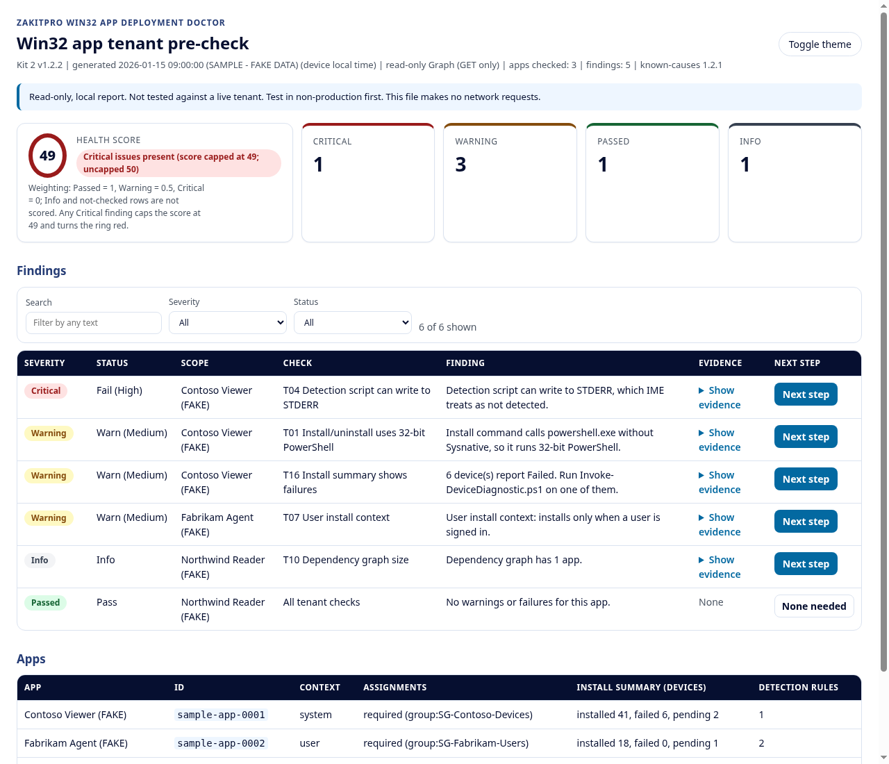
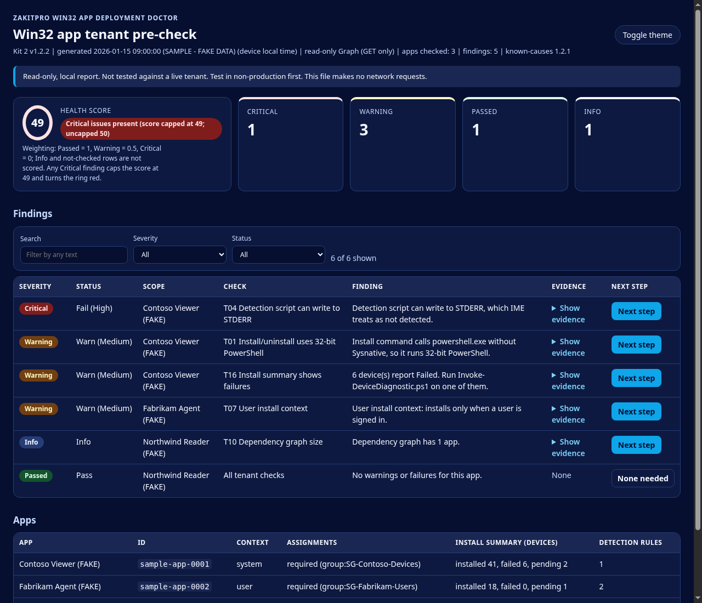

# Win32 Deployment Doctor (beta scripts)

Read-only PowerShell diagnostics for Microsoft Intune Win32 app deployments (Kit 2 scripts v1.2.3), from ZakitPro.

> **Warning: not tested against a live tenant.** These scripts have been checked only with PSScriptAnalyzer and Pester unit tests that use mocked Graph responses and synthetic data. They have not been run on a real tenant or a real device.
>
> **Test in non-production first.** Run them in a test tenant and on a test device before you use them anywhere else. They are provided AS IS under the MIT license, with no warranty.

**Get the full kit.** These scripts are free and will stay free. The paid Win32 App Deployment Doctor adds a 54-page guide and the explanations and fixes for its 22 known causes. It's planned for Tuesday, December 1, 2026, sold together with the Autopilot kit. [Join the waitlist](https://www.zakitpro.com/doctor/win32/?utm_source=github&utm_medium=readme&utm_campaign=doctor_waitlist&utm_content=kit2_top)

## Versions
| Script file | Script version | Matching paid kit version | Last updated |
|---|---|---|---|
| `scripts/Invoke-TenantPreCheck.ps1` | 1.2.3 | Kit 2 v1.3.3 | 2026-10-19 |
| `scripts/Invoke-DeviceDiagnostic.ps1` | 1.2.3 | Kit 2 v1.3.3 | 2026-10-19 |

Script versions are numbered separately from kit (guide) versions: a kit version changes whenever the guide or extras change, while a script version changes only when that script's code changes. The scripts here are byte-identical to the ones in the matching paid kit. See [CHANGELOG.md](CHANGELOG.md).

## How this differs from Pre-Check Lite
The free [Pre-Check Lite](https://zakitpro.com/doctor/) is one script that runs 3 read-only Device Prep tenant checks (service principal, device group, local admin) and prints PASS/FAIL/WARN/SKIP lines. Pre-Check Lite does not cover Win32 apps. This repo is the full Kit 2 script set: a Win32 app tenant audit and an on-device IME log diagnostic, with HTML/JSON reports.

## Quick start
**PowerShell:** Windows PowerShell 5.1 or PowerShell 7.x (every script has `#Requires -Version 5.1`). The device diagnostic runs on the Windows device itself.

**Graph module (tenant script only):**
```powershell
Install-Module Microsoft.Graph.Authentication -Scope CurrentUser -MinimumVersion 2.0
```
Sign in with an account that can read Intune and Entra (for example Global Reader plus an Intune read-only role). If execution policy blocks a script, review it, then `Unblock-File` that file. Don't set the policy to Bypass globally.

**Run (from the repository root):**
```powershell
# Tenant pre-check (Win32 apps). Report folder default: .\ZakitPro-Kit2-Reports
.\scripts\Invoke-TenantPreCheck.ps1 -TenantId contoso.onmicrosoft.com -AppNameFilter "Contoso" -OutputPath C:\Temp\DD
# -SkipConnect reuses an existing Connect-MgGraph session.

# Device diagnostic. Local admin recommended (the IME log folder ACL). Report folder default: %TEMP%\ZakitPro-Kit2
.\scripts\Invoke-DeviceDiagnostic.ps1 -OutputPath C:\Temp\DD

# Try it first on the synthetic logs in sample-logs\ (see sample-logs\README.md):
.\scripts\Invoke-DeviceDiagnostic.ps1 -LogPath .\sample-logs\problem -SkipRegistry -OutputPath C:\Temp\DD

# Offline, on logs copied from another device, cross-referenced with the tenant report:
.\scripts\Invoke-DeviceDiagnostic.ps1 -LogPath D:\Collected\Logs -SkipRegistry -TenantReportPath C:\Temp\DD\Kit2-TenantPreCheck-<stamp>.json
```
**Report results:** open a [Test report](https://github.com/zakopenc/win32-deployment-doctor-beta/issues/new?template=test-report.md). Before you post, remove tenant names, tenant/device/user IDs, UPNs and any secrets, and don't attach unredacted reports.

## What is in this repo
```
scripts/Invoke-TenantPreCheck.ps1     Win32 app tenant audit (Graph, read-only)
scripts/Invoke-DeviceDiagnostic.ps1   On-device IME log diagnostic (no Graph, no network)
scripts/known-causes.json             Signal map the scripts need to run (see below)
scripts/tests/                        Pester tests and synthetic log fixtures
sample-logs/                          Synthetic healthy/problem AppWorkload logs
docs/                                 Sample report (fake data) and its generator
third-party/                          License files of MIT reference projects (see CREDITS.md)
```

`scripts/known-causes.json` is a trimmed signal map: cause IDs, match patterns, status and source links. The scripts load it to label findings, so it is required. The explanations and fixes from the paid kit are not included; reports show "Removed from the beta scripts repo" in their place.

## Local HTML report
Each script writes one self-contained HTML dashboard next to its JSON report. It uses inline CSS and inline vanilla JavaScript only, with no external files, CDNs, web fonts or telemetry. A Content-Security-Policy meta tag blocks network requests from the page.
- **Summary header:** a health score plus status cards (Critical, Warning, Passed, Info). Weighting: Passed = 1, Warning = 0.5, Critical = 0; Info and not-checked rows are not scored. Score = `round(100 x (Passed + 0.5 x Warning) / (Passed + Warning + Critical))`. Any Critical finding caps the score at 49, turns the ring red and shows "Critical issues present".
- **Findings table:** severity pills with text labels, the real status, scope, check, the finding's detail, collapsible HTML-escaped evidence, and a **Next step** link to Microsoft Learn (or the KC/check code when no Learn page exists).
- **Filters, themes, print:** filter by severity/status and search text; light and dark themes (follows `prefers-color-scheme`, plus a toggle); print CSS expands all evidence.
- **`-NoHtml`:** writes only the JSON report. The local report files are the only thing the scripts write.

| Light | Dark |
|---|---|
|  |  |

*Generated by `docs/New-SampleReport.ps1` from invented data. Open [docs/sample-report.html](docs/sample-report.html) locally to try the filters.*

## What each script checks
### `Invoke-TenantPreCheck.ps1` (tenant, read-only Graph)
For each Win32 app: definition, assignments, dependencies/supersedence and install summary. Checks: 32-bit PowerShell in install/uninstall; environment variables in uninstall; ServiceUI in commands; detection scripts that can write to STDERR or have no STDOUT write; product-code detection pinned to a version; detection rules hard-coding a 32-bit location or using the 64-bit view; user install context; large package with default timeout (heuristic); 1618 not mapped to Retry; hard-reboot return codes; dependency graph size; supersedence chain length; superseding app not assigned; dependency on a superseded app; supersedence auto-update; allowedArchitectures vs. applicableArchitectures; install-summary failures; untargeted auto-install dependencies; and (optional) the Intune Windows Agent enterprise app being disabled. Each app is checked on its own: one that can't be evaluated gets a Warning (`T00`) and the rest are still reported. A guard refuses any HTTP method other than GET. Background: [Win32 app management in Microsoft Intune](https://learn.microsoft.com/intune/intune-service/apps/apps-win32-app-management).

### `Invoke-DeviceDiagnostic.ps1` (device, no Graph)
Parses IME logs (IntuneManagementExtension, AppWorkload, AppActionProcessor, including rolled-over files) with a clean-room CMTrace parser, reads the `Win32Apps` registry state and the IME service version, builds a per-app timeline and matches signals to the signal map. Can analyse a copied log folder offline (`-LogPath ... -SkipRegistry`) and cross-reference the tenant report.

## Microsoft Graph scopes (delegated, read-only)
Taken from the scripts. No ReadWrite scope is requested.

| Script | Scopes |
|---|---|
| Tenant pre-check | `DeviceManagementApps.Read.All`, `Group.Read.All`; plus `Application.Read.All` only with `-IncludeAgentAppCheck` |
| Device diagnostic | None (no Graph, no network) |

The tenant script needs `Microsoft.Graph.Authentication` 2.x.

Several endpoints are Graph `/beta` and can change. Permissions reference: [Microsoft Graph permissions reference](https://learn.microsoft.com/graph/permissions-reference).

## Running the tests
```powershell
Install-Module Pester -MinimumVersion 5.0 -Scope CurrentUser
Install-Module PSScriptAnalyzer -Scope CurrentUser
Invoke-Pester -Path ./scripts/tests
```

## Get the full kit

The scripts in this repo are the same files that ship in the paid kit. You can check them against the hashes at https://www.zakitpro.com/verify/. The Win32 App Deployment Doctor adds what this repo leaves out:

- a 54-page guide: triage, six runbook chapters and worked examples on fake data
- the explanations and fixes for the 22 known causes (where your report says "Removed from the beta scripts repo")
- the two procedures that change state, written up with rollback notes (the scripts never make changes)
- a printable flowchart and a one-page quick start
- quarterly known-cause updates for 12 months

It's planned for Tuesday, December 1, 2026, sold together with the Autopilot + Device Prep kit, and waitlist members hear first: [join the waitlist](https://www.zakitpro.com/doctor/win32/?utm_source=github&utm_medium=readme&utm_campaign=doctor_waitlist&utm_content=kit2_end).

Want to see a report before you run anything? [docs/sample-report.html](https://github.com/zakopenc/win32-deployment-doctor-beta/blob/main/docs/sample-report.html) is a tenant pre-check report built from invented contoso-style apps. GitHub shows the file's source, so download it (Raw, then save) and open it in a browser.

### Ran it on a real tenant or device?

Please open a [Test report](https://github.com/zakopenc/win32-deployment-doctor-beta/issues/new?template=test-report.md), scrubbed first: no tenant names, IDs, UPNs, serial numbers, hostnames or secrets. The paid kit doesn't go on sale until at least one tester has reported a run on a real tenant or device, so a clean run with nothing to report helps too. I'll ask before I quote or count anything you post.

## Related
- Win32 app scripts: [zakopenc/win32-deployment-doctor-beta](https://github.com/zakopenc/win32-deployment-doctor-beta)
- Autopilot / Device Prep scripts: [zakopenc/autopilot-deployment-doctor-beta](https://github.com/zakopenc/autopilot-deployment-doctor-beta)
- The earlier combined repo, [zakopenc/deployment-doctor-beta](https://github.com/zakopenc/deployment-doctor-beta), is archived.

## License
MIT, see [LICENSE](LICENSE). Third-party credits: [CREDITS.md](CREDITS.md). Checksums: [SHA256SUMS.txt](SHA256SUMS.txt).
